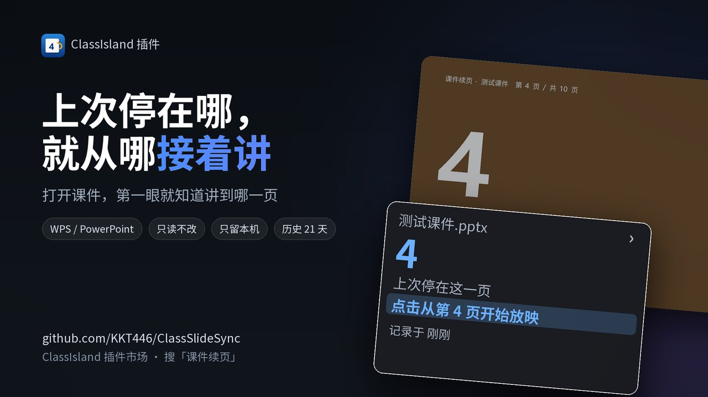

# 课件续页

**记住每份课件讲到第几页。下次打开同一份课件，点一下就从那一页接着讲。**

▶ 点开上图看演示（B 站，28 秒）

支持 PowerPoint、WPS 演示、希沃白板 ｜ ClassIsland 2.1 插件 ｜ 只在本地记，不联网

## 安装

1. ClassIsland 2.1 → **应用设置 → 插件 → 导入插件包**，选下载好的 ClassSlideSync.Plugin.cipx（也可以在插件市场里直接搜「课件续页」）。
2. 打开任意一份课件：屏幕边上会弹出小窗，写着「上次停在第 N 页」。
3. 进 **应用设置 → 插件 → 课件续页** 可以调卡片样式、配学科文件夹、跑一遍新手引导。

## 怎么用

1. 打开课件（双击文件，或者先开 PowerPoint/WPS 再打开课件都行）。
   屏幕右侧会自动弹出小窗，写着文件名、**上次停在第几页**。
2. 点小窗里高亮的那行「点击从第 N 页开始放映」——立刻全屏，从第 N 页接着讲。
3. 15 秒没碰它会自动贴到屏幕边缘，收成一条小竖条，不挡板书：
   - 想再打开，点那条小竖条；
   - 不想让它占地方，点小窗右上角的箭头 `❯` 收回。**收回以后就一直收着**——翻页不会把它再弹开（页码照样记着）。
4. 想换个地方待着：**按住卡片直接拖到你要的位置**，松手就贴到最近的那条边并记下来，下次启动还在那儿。
5. 下课、或者把演示软件关掉，卡片自动消失，**屏幕上不留东西**。

## 学科课件文件夹（上课自动打开）

- 在「应用设置 → 插件 → 课件续页 → 学科课件文件夹」里一行一行配：**科目名 → 文件夹**。
  科目名按 ClassIsland 课表里的科目写（语文 / 数学 / 英语 / 心/数 …）；写全名或简称都能认出来。
- 配好以后，**每节课一开始，插件就把这一科的课件文件夹打开**，直接挑课件就行；同一节课只开一次。
- 没配过的科目、或者文件夹不在了，插件不动手，只在 `app.log` 里记一行。

## 行为细则

- **检测到演示软件就显示**：PowerPoint / WPS 在跑、并且课件打开着，就显示卡片（默认不分上不上课）。
- **跟课表启停**：上课前 2 分钟开始待命（可改），下课后再盯 2 分钟，把"最后停在第几页"记完。
- **只看不改**：插件只读取课件的页数和当前页码，不会改动、也不会把课件上传到任何地方。
- **改过的课件会认出来**：同一份课件内容改过（指纹不同）时，会提示"文件在那之后被改过，页码可能已偏移"。
- **停在最后一页也算数**：讲到最后一页直接结束放映、或者直接关掉文件，也会记成"停在第 N 页"，下次打开就能一键跳回去。
- **翻页不打扰**：卡片收起后，翻页只更新页码，不会自动展开。
- **用完不留尾巴**：插件用完就放开 PowerPoint / WPS 的自动化引用，空闲时降频，不会让 WPS 关不掉。
- **历史保留 21 天**（可改），过期记录每天自动清一次。

## 设置项（应用设置 → 插件 → 课件续页）

- **检测到 PPT 就显示卡片**：开（默认）= 只要课件开着就显示，不管上不上课；关 = 只在课表时段内显示，下课铃一响就隐藏（后台仍继续记页码）。
- **提前多少秒待命**：默认 120 秒（上课前 2 分钟）。
- **下课后保留多久**：默认 120 秒，这段时间只是让插件继续盯着课件、把页码记完（卡片本身下课就隐藏）。
- **学科课件文件夹**：科目 → 文件夹对照表（可加行、可删行），**上课自动打开文件夹**默认开。
- **自动贴边 / 多少秒后贴边**：默认开、15 秒。
- **卡片贴左边还是右边**、垂直位置（也可以直接拖动卡片改）、大小、圆角、字体、透明度、跟随 ClassIsland 主题、显示哪几行（文件名 / 页码 / 上下文 / 状态行 / 跳转行）、点卡片跳页开关。
- **历史保留天数**、**诊断日志**（排查用，平时关着，关了 `app.log` 几乎不写东西）。

## 自测用的测试课件

- 插件里带了一份 `test\纯页码课件.pptx`（10 页，每页只有一个大页码、一种底色，没有任何说明文字），装好就能拿它试功能，随便改随便删。仓库里另有一份带用法说明的 `test\测试课件.pptx`，那是开发自测用的。
- 自测四步：
  1. 放映它，屏幕边上应出现卡片，写「共 10 页」；
  2. 翻到第 5 页，点卡片右上角 `❯` 收起，再往后翻两页——卡片**不应该**自己弹开；
  3. 结束放映（或者直接关掉文件），等两秒；`app.log` 里应出现 `session recorded: 纯页码课件.pptx pages …`，末尾页数就是刚才停的那页（**包括停在最后一页**的情况）；
  4. 再打开同一份文件，卡片应写「上次停在第 N 页」，点那一行直接跳到第 N 页。
- 想验证另外两件事：
  - **拖动记忆**：把卡片拖到别处，`app.log` 会写 `card moved: side=… v=…%`；重启 ClassIsland 后卡片应回到那个位置。
  - **上课自动开文件夹**：上课时间到，`app.log` 会写 `subject folder: opened …`，并弹出该科目的资源管理器窗口。

## 数据放在哪

ClassIsland 数据目录下：

- `Config\Plugins\ClassSlideSync.Plugin\ledger.json` —— 历史台账（哪个文件、哪节课、从第几页到第几页）。删掉它就等于清空历史，不影响本插件正常使用。
- `Config\Plugins\ClassSlideSync.Plugin\app.log` —— 运行日志（诊断日志开着时才详细）。
- `Config\Plugins\ClassSlideSync.Plugin\SyncSettings.json` —— 本插件的设置。

## 已知限制

- 刚打开课件的一两秒里，WPS 的自动化接口还没就绪：卡片会先靠窗口标题认出课件、直接显示「上次停在第 N 页」，但**实时页码**要等接口就绪后才跟上。接口超过 4 秒不回话时，插件会暂停 6 秒再试（`app.log` 里记 `slow COM: …`），这段时间卡片不卡、只是页码不刷新。
- 只跟踪 PowerPoint 和 WPS 演示，其他演示软件不支持。
- 仅 Windows（ClassIsland 2.1.0.1 上开发测试）。

## 更新日志

### 1.2.2.0（2026-10-25）

- **每页停留单独记**：翻页时结算上一页停了多久，存进 `dwell.json`（按课件、按科目都能算）；同一页来回翻，秒数和次数都累加
- **「还剩约几分钟」改用实测速度**：本次课实测（够 3 页且够 60 秒才采用）→ 这份课件历史 → 全库 → 60 秒/页，四档回退，夹在 8–600 秒之间
- **课件改过也能对齐页码**：读两份课件每一页的文字做匹配，删页/插页按上下文平移投票定页；实在对不上就直说「改得太多，页码对不上」，不再瞎跳
- **课件移动/改名自动认回**：按内容和文件名在科目文件夹里找，找到就把整份历史迁过去；两份都像时宁可不动
- **药丸按科目着色**：内置 14 科配色，设置里可逐科改；药丸里的页码也能单独关掉
- **主界面组件「课件进度」**：设置 → 主界面 → 编辑组件 里能拖进任意一行，没课件时自动隐藏
- 自动化新增触发器「讲到第 X 页」，以及跳到指定页、打开课件文件夹、清除当前课件记录三个行动；「发一条 Windows 提示」支持自定义标题、正文、时长、置顶和 `{deck}{page}{total}{remaining}` 占位符

### 1.2.1.6（2026-10-25）

- **卡片改版**：整卡 236×176（比原来矮 26px），大页码配「共 N 页 / 还剩 N 页 · 约 M 分钟」两行；整行实心按钮、底部进度条。
- **收起把手改到屏幕外侧**：原来在卡片内侧的箭头，现在是一条贴着屏幕边缘的竖带（和卡片等高），收起来之后药丸竖着显示进度，一眼就知道讲到哪。
- **新增控制面板**：卡片右上角齿轮打开独立窗口，分「课件库 / 设置 / 关于」三页；课件库可按科目筛选、搜索、翻页，设置页把插件全部开关搬了进去，窗口大小和位置会记住。
- **提前预备**：上课前 2 分钟，如果这一科上次没讲完，卡片会自己亮起来，写着上次停在第几页，点一下直接打开课件并跳到那一页。
- **下课提醒**：下课且课件已经退出时，弹一条 Windows 通知，写上这节课记到了第几页、还剩几页。
- **历史写清节次**：每条记录显示「周三 第 3 节 · 15:20 · 第 5 → 8 页」，不再只是一串时间。
- **同名课件会问一句**：两份同名但内容不同的课件，点进去先问「哪一份？」，选错了也不会跳到另一份。
- **导出记录**：控制面板里一键导出整本台账成 CSV（Excel 直接能开）。
- **接入 ClassIsland 自动化**：动作有打开上次未讲完的课件、让卡片显示/隐藏、跳到指定页、打开课件文件夹、清除当前课件记录，还有「发一条 Windows 提示」——标题、正文、时长、是否置顶都能自己写，正文里可以用 `{deck}` `{page}` `{total}` `{remaining}` 占位；规则是「上次课件没讲完」。
- **修掉「删记录没删好」**：以前删一份课件的记录只清掉一条，现在按课件名匹配台账桶，一次把这份课件的全部记录清空。
- **修掉「控制面板打不开」**：面板不再要求正在上课，什么时候都能打开。

### 1.2.1.5（2026-10-24）

- 修复若干 bug。

### 1.2.0.0（2026-10-18）

- **新增「打开过的课件」面板**：点卡片右上角的文件夹图标，列出所有讲过的课件；点一份进去是它的历史，点某条记录直接跳到那份文件的对应页。
- **新增「历史 · N 次」**：卡片底部一行，点开是这份课件讲过的每一次（页码、时间、讲了多久），点一条就跳回去。
- **新增新手引导**：插件设置页里有「新手引导」，分步介绍卡片怎么用、历史怎么翻、数据存在哪。
- **新增内置示例课件**：`test\纯页码课件.pptx`，10 页纯页码，想试功能可以直接拿它放一遍。
- **新增希沃白板支持**：在希沃白板里放映时也能记住页码、点卡片跳转。
- 修复若干个掉面的 bug。

### 1.1.0.0（2026-10-17）

- **修掉「打开WPS，插件悬浮窗需等待最多20秒才出现的bug」**：此前每张卡片都注册同一个窗口类名，第二张卡片会沿用第一张（已经销毁）窗口的消息过程，消息全落空；同时窗口过程委托只被卡片实例引用，实例一回收委托就被 GC 带走，下一条窗口消息会让整个 ClassIsland 进程当场终止（Windows 事件日志里是 `A callback was made on a garbage collected delegate of type '…NativeOverlayCard+WndProcDelegate::Invoke'`）。现在每张卡片用独立类名，委托使用静态引用。
- **修掉「课件关掉后再打开，插件仍需等待最多15秒才出现的bug才有反应」**：以前使用 PowerPoint/WPS 的自动化接口判断有没有在放映，而接口在 WPS 刚启动时插口仍在但无响应"接受调用但不回话"，现在使用梁圣赔我的21.54元调用ds4.1flash在后台检测WPS的进程及准备其他方案。
- **课件打开插件立即响应**：新增按窗口标题识别课件，打开文件后立刻显示文件名与「上次停在第 N 页」，不用再等"正在识别课件…"。
- 释放自动化引用时不再强制 GC（改用 `Marshal.FinalReleaseComObject`），避免释放竞态。
- 引擎线程还在调用自动化接口时不再释放引用，避免 WPS 卡死坠机。

### 1.0.1.0（2026-10-15）

- 第一个版本：记录每份课件的讲授进度，下次打开同一份课件时，在屏幕边上显示「上次停在第几页」，点一下就从那一页接着放映；支持 PowerPoint 与 WPS 演示。
